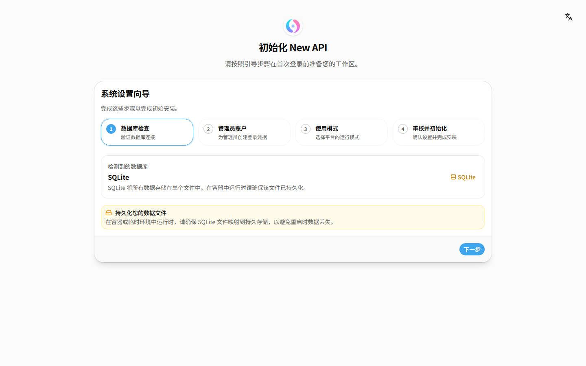
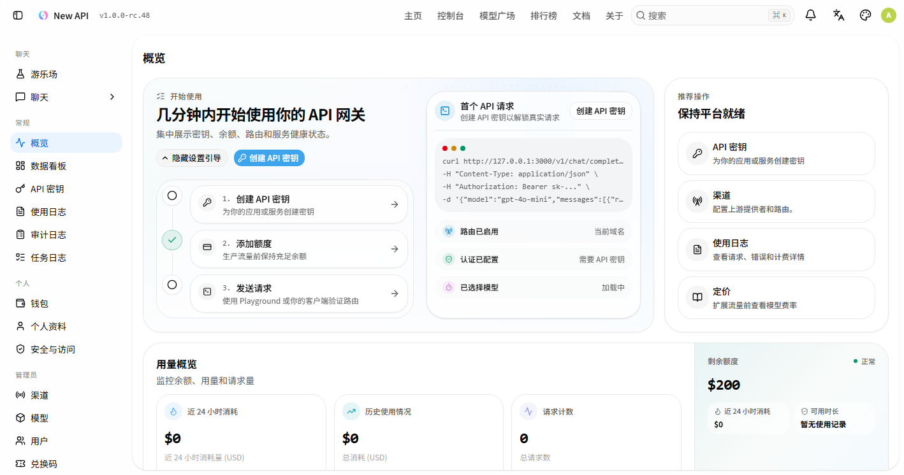
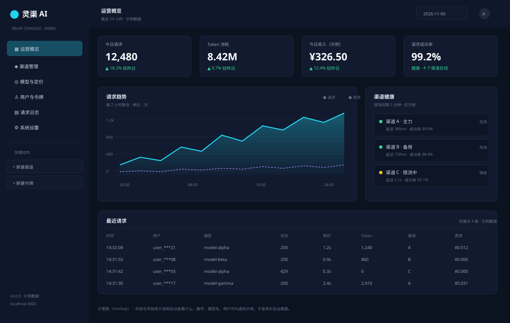
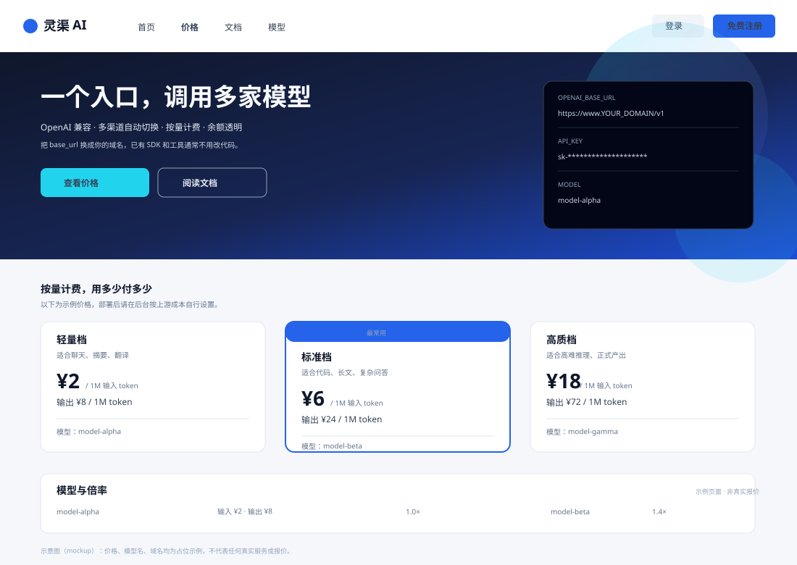
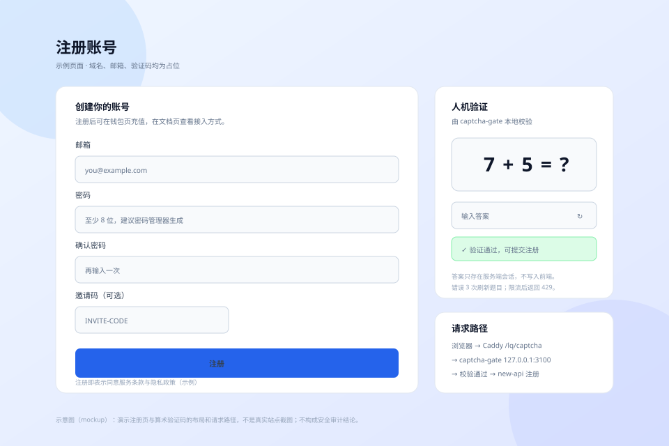
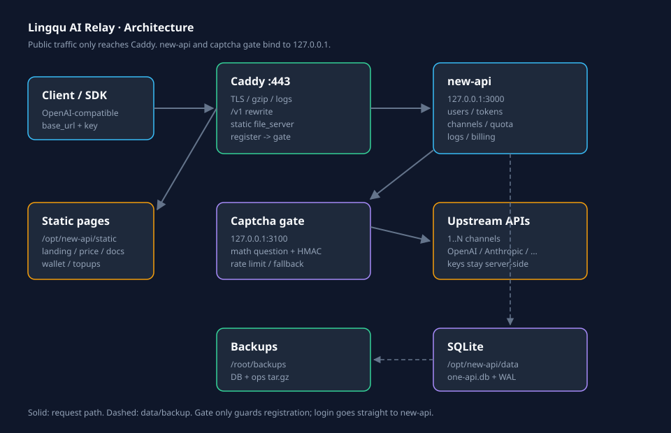

# Lingqu AI Relay · new-api + Caddy Replication Manual

> **Language / 语言**: [中文](README.md) | English

> Use a small server to aggregate multiple upstream AI APIs into a single **OpenAI-compatible endpoint**, with users, tokens, quota, top-ups, a custom frontend, registration captcha, monitoring, and backups.
>
> This is a **sanitized template**: domain, email, keys, and payment accounts are all placeholders. Fill in your own.
>
> - Applies to: Ubuntu 22.04 / 24.04
> - Stack: Docker + new-api + Caddy + SQLite
> - Tested scale: 2 vCPU / 1.5–2 GB RAM / 40 GB disk, a personal site with modest daily request volume
> - Doc updated: 2026-11
> - Not comfortable with AI? Read this `README`.
> - Want AI to install it? Hand the whole `AI-DEPLOY.en.md` to an AI.

<p>
  
  
  
  
  
  
</p>

## Project Overview

This is a **replicable AI API relay deployment template**: Docker + new-api + Caddy + SQLite, with users, tokens, quota, top-ups, a custom frontend, registration captcha, monitoring, and backups.

It is not a "buy a server and money prints itself" project. Upstream terms of service, content compliance, payments, and refunds are all your responsibility; this document puts the risks up front.

**Who it is for**

- People who want to consolidate several upstream keys into one OpenAI-compatible endpoint.
- Small teams that need users, quota, logs, and backups for internal use.
- People who want to learn a complete new-api / Caddy / Docker deployment.

**Who it is not for**

- People who want "zero maintenance, zero compliance work, passive income".
- People unwilling to deal with domains, HTTPS, payments, and abuse complaints.
- People who just need one key for one model; pointing the official base_url directly is simpler.

**What you get**

| Artifact | Location |
|---|---|
| Ten-step deployment for humans | `README.en.md` (this document) |
| AI deployment protocol | `AI-DEPLOY.en.md` (Chinese: `AI-DEPLOY.md`) |
| Docker / Caddy / captcha gateway | `deploy/` |
| Initialization, backup, health check, model probing | `scripts/` |
| Architecture, installation, operations, security, payment, frontend | `docs/` (Chinese) |
| Real screenshots + rendered mockups | `docs/images/` |

> English scope: this README and `AI-DEPLOY.en.md` are complete translations. The optional deep-dive files under `docs/` are currently in Chinese.

**Three steps for beginners**

1. Read Section 0, "This Is Not a Get-Rich-Quick Site", and confirm your use case is compliant.
2. Prepare a domain, a server, and upstream keys; check off every item in the Section 3 checklist.
3. Follow the ten steps in Section 4; get `/v1/models` working first, then enable registration and top-ups.

---

## Preview

**Real screenshots from this machine**: new-api `v1.0.0-rc.48` setup wizard plus the admin panel right after initialization (no data).





> A freshly created admin panel is empty, so below are three "after data" mockups to show the final result. Domain, users, model names, and prices are placeholder examples.

**Admin operations overview (rendered with data)**



**Public price page (mockup)**



**Registration captcha gateway (mockup)**



---

## Table of Contents

- [0. Read First: This Is Not a "Get-Rich-Quick" Site](#0-read-first-this-is-not-a-get-rich-quick-site)
- [1. What It Can Do](#1-what-it-can-do)
- [2. Architecture](#2-architecture)
- [3. Preparation Checklist](#3-preparation-checklist)
- [4. Ten-Step Deployment](#4-ten-step-deployment)
- [5. Directories and Files](#5-directories-and-files)
- [6. Billing and Quota](#6-billing-and-quota)
- [7. Registration Captcha Gateway](#7-registration-captcha-gateway)
- [8. Monitoring, Backup, and Recovery](#8-monitoring-backup-and-recovery)
- [9. Common Operations Commands](#9-common-operations-commands)
- [10. Troubleshooting Table](#10-troubleshooting-table)
- [11. Security Checklist](#11-security-checklist)
- [12. Cost and Compliance](#12-cost-and-compliance)
- [Appendix A: Acceptance Checklist](#appendix-a-acceptance-checklist)
- [Appendix B: File Reference](#appendix-b-file-reference)

---

## 0. Read First: This Is Not a "Get-Rich-Quick" Site

The technology here is not hard. What is hard is **compliance and upstream terms of service**.

- The API you resell may violate the upstream provider's terms of service.
- You have to handle user data, payments, refunds, and abuse.
- You bear the content compliance responsibility yourself.
- Do not turn it into a public site with "no login, no verification, free for anyone to hammer".

**Recommended uses**:

- A single entry point for your own multiple upstream keys
- Internal use by a small team
- Distribution with explicit authorization
- A complete project for learning new-api / Caddy / Docker

If you only use it yourself, you actually don't need this much: one new-api container plus Caddy is enough. Users, top-ups, and the frontend are only needed for "public operations".

---

## 1. What It Can Do

| Capability | Description |
|---|---|
| Unified entry point | One `base_url` + one key to call models from multiple upstreams |
| OpenAI-compatible | `/v1/chat/completions`, `/v1/models`, `/v1/responses`, etc. |
| Multi-channel | One model can map to several upstreams with automatic failover (per new-api policy) |
| User system | Registration, login, tokens, quota, groups |
| Billing | Per token or per request, with adjustable multipliers |
| Top-up | Integrates with 易支付 (YiPay) and similar (optional) |
| Custom frontend | Landing page, price page, docs page, wallet page |
| Registration verification | Self-hosted arithmetic-question gateway to block bot registrations |
| Observability | Model health probes, upstream price comparison, access logs |
| Recoverability | SQLite online backup + packaged config files |

---

## 2. Architecture



```text
User / SDK
    │  https://www.YOUR_DOMAIN
    ▼
Caddy (443)
    ├─ automatic HTTPS, gzip/zstd, access logs
    ├─ /api/user/register ──► captcha-gate (127.0.0.1:3100)
    ├─ /lq/captcha*       ──► captcha-gate
    ├─ /, /price, /docs, /wallet ... ──► /opt/new-api/static/*.html
    ├─ /chat/completions, /responses, /messages ──► auto-prepend /v1
    └─ everything else ──► reverse_proxy 127.0.0.1:3000
                          │
                    new-api container
                          │
                    SQLite /opt/new-api/data/one-api.db
                          │
                    multiple upstream channels
```

**Key design decisions**:

1. Only 443 is exposed publicly (and 80 for ACME).
2. new-api listens only on `127.0.0.1:3000` and is never exposed directly.
3. Static pages are read from disk by Caddy, so editing HTML does not require restarting the container.
4. Registration goes through the captcha gateway; login does not.
5. Three rewrites for `/chat/completions` and friends let clients that forget `/v1` still work.

---

## 3. Preparation Checklist

### 3.1 Server

| Item | Minimum | Recommended |
|---|---|---|
| OS | Ubuntu 22.04 | Ubuntu 24.04 |
| CPU | 1 vCPU | 2 vCPU |
| RAM | 1.5 GB | 2 GB |
| Disk | 20 GB | 40 GB |
| Bandwidth | 3 M | 5 M+ |
| Architecture | x86_64 | x86_64 |

> 1.5 GB of RAM works, but running Docker + Caddy + backups at the same time is tight. 2 GB is more stable.
> Do not use a 512 MB tiny instance; building or upgrading will OOM.

### 3.2 Domain and DNS

- One domain where you can edit DNS.
- Two A records:
  - `@` → server IP
  - `www` → server IP
- Servers in mainland China need ICP filing (备案); Hong Kong/overseas do not (but latency and compliance differ).

### 3.3 Ports

| Port | Purpose | Required |
|---|---|---|
| 22 | SSH | Yes |
| 80 | ACME certificate validation | Yes |
| 443 | Website/API | Yes |
| 3000 | new-api | **listen on 127.0.0.1 only** |
| 3100 | Captcha gateway | **listen on 127.0.0.1 only** |

### 3.4 Upstream

- At least 1 upstream API: `base_url` + `key` + list of supported models.
- 2–3 are recommended for redundancy.
- **Never write upstream keys into Git.**

### 3.5 Payment (optional)

- `pid`, `key`, and `notify_url` from 易支付 (YiPay) or another payment aggregator.
- It works without payment integration: manual top-ups / redemption codes.
- Before going live with payments, test with a small amount first to confirm funds arrive.

---

## 4. Ten-Step Deployment

> The commands below assume `root`. Regular users should prepend `sudo`.
> Replace `YOUR_DOMAIN` with your domain, for example `api.example.com`.

### Step 1 · DNS

In your domain provider's panel, add:

```text
A  @    YOUR_SERVER_IP
A  www  YOUR_SERVER_IP
```

Verify:

```bash
dig +short YOUR_DOMAIN
dig +short www.YOUR_DOMAIN
```

Continue only after both return the server IP.

### Step 2 · Install Dependencies

```bash
apt update
apt install -y docker.io docker-compose-v2 caddy sqlite3 python3 curl rsync
systemctl enable --now docker
```

Verify:

```bash
docker --version
docker compose version
caddy version
sqlite3 --version
```

> If `docker-compose-v2` cannot be found, use `docker-compose-plugin` or `apt install docker-compose`.

### Step 3 · Start new-api

```bash
mkdir -p /opt/new-api/data /opt/new-api/static
cd /opt/new-api
```

Copy the repository's `deploy/docker-compose.yml` to `/opt/new-api/docker-compose.yml`:

```bash
cp /root/lingqu-relay/deploy/docker-compose.yml /opt/new-api/docker-compose.yml
cd /opt/new-api
docker compose up -d
```

Verify:

```bash
docker ps --filter name=new-api
curl -s -o /dev/null -w '%{http_code}\n' http://127.0.0.1:3000/api/status
```

Expect `200`.

> The first start pulls the image; a few minutes is normal. Watch logs with `docker logs -f new-api`.

### Step 4 · Configure Caddy

```bash
cp /root/lingqu-relay/deploy/Caddyfile.example /etc/caddy/Caddyfile
DOMAIN=api.example.com
EMAIL=admin@example.com
sed -i "s/YOUR_DOMAIN/$DOMAIN/g; s/YOUR_EMAIL/$EMAIL/g" /etc/caddy/Caddyfile
```

> The above is only an example. Replace `DOMAIN` with your real domain (without `www`) and `EMAIL` with your email.
> You can also open `/etc/caddy/Caddyfile` in an editor and replace the values by hand.

Validate and reload:

```bash
caddy validate --config /etc/caddy/Caddyfile
systemctl reload caddy
systemctl status caddy --no-pager
```

Verify HTTPS:

```bash
curl -sI https://www.YOUR_DOMAIN | head -5
```

Expect `HTTP/2 200` or `301/302`.

> Caddy obtains the certificate automatically. Port 80 must be reachable from the public internet, otherwise ACME fails.

### Step 5 · Create the Administrator

Open in a browser:

```text
https://www.YOUR_DOMAIN
```

On the first visit it prompts you to initialize; create the administrator account as instructed.

> Do this immediately:
> 1. Change the default password.
> 2. Enable login verification (if available).
> 3. Turn off public registration (for now) and enable it only after the captcha gateway is configured.

### Step 6 · Add Channels

Admin → 渠道 (Channels) → 新建 (Create):

| Field | What to enter |
|---|---|
| 类型 (Type) | OpenAI-compatible / the matching upstream type |
| Base URL | The address provided by the upstream, usually ending in `/v1` |
| Key | Upstream key |
| 模型 (Models) | Model names the upstream supports, one per line |
| 分组 (Group) | Default / VIP (optional) |

After saving, click 测试 (Test), or:

```bash
NEWAPI_BASE=http://127.0.0.1:3000 NEWAPI_KEY=YOUR_TOKEN python3 scripts/probe-models.py
```

> Do not fill in every model. Only list models the upstream actually has, otherwise the model page turns all red.

### Step 7 · Billing and Quota

Admin → 设置 (Settings):

| Setting | Suggested | Notes |
|---|---|---|
| Price | 1 | 1 CNY = 1 USD of quota (per your pricing) |
| QuotaPerUnit | 500000 | 1 USD = 500000 quota |
| MinTopUp | 1 | Minimum top-up |
| QuotaForNewUser | 0 | New users get no quota |
| 注册 (Registration) | Off for now | Turn on after the captcha is configured |

Generate the price table with a script; do not hand-edit the JSON.

### Step 8 · Registration Captcha Gateway

```bash
cp /root/lingqu-relay/deploy/turnstile_gate.py /root/turnstile_gate.py
cp /root/lingqu-relay/deploy/turnstile-gate.service /etc/systemd/system/turnstile-gate.service
systemctl daemon-reload
systemctl enable --now turnstile-gate
systemctl status turnstile-gate --no-pager
```

Verify:

```bash
curl -s http://127.0.0.1:3100/lq/captcha
```

Expect JSON containing `token` and `q`.

Confirm in Caddy that these two entries point to 3100:

```text
handle /lq/captcha* {
    reverse_proxy 127.0.0.1:3100
}
handle /api/user/register {
    reverse_proxy 127.0.0.1:3100
}
```

> This gateway uses **self-hosted arithmetic questions**, not Cloudflare Turnstile.
> It generates a `token`; the frontend submits the answer along with it, and only after validation does the gateway forward the request to new-api.
> The secret file `/root/lq_captcha.secret` is generated automatically; **do not commit it**.

### Step 9 · Scheduled Tasks

```bash
crontab -l > /tmp/crontab.bak 2>/dev/null || true
crontab /root/lingqu-relay/deploy/crontab.example
crontab -l
```

Example tasks:

| Time | Script | Purpose |
|---|---|---|
| `30 4 * * *` | `backup.sh` | Daily backup |
| `40 4 * * *` | `probe-models.py` | Model health probing |
| `*/10 * * * *` | `health-check.sh` | Site health check |
| `21 * * * *` | Price table generation | Public pricing |

> Always back up crontab before changing it. Scripts written on Windows with a BOM will make `crontab` fail to parse.

### Step 10 · Acceptance

```bash
bash /root/lingqu-relay/scripts/health-check.sh
bash /root/lingqu-relay/scripts/backup.sh
ls -lh /root/backups
```

Check each item in the browser:

- [ ] `https://www.YOUR_DOMAIN` opens
- [ ] You can log in to the admin panel
- [ ] The channel test passes
- [ ] `/v1/models` returns a model list
- [ ] A captcha appears on the registration page
- [ ] Login does not go through the captcha
- [ ] The price page / docs page / wallet page open
- [ ] A small top-up arrives (if payment is integrated)
- [ ] `crontab -l` shows tasks
- [ ] `/root/backups` contains today's files

---

## 5. Directories and Files

```text
/opt/new-api/
├─ docker-compose.yml
├─ data/
│  ├─ one-api.db          ★ core database
│  ├─ one-api.db-wal      ★ backup must not copy .db alone
│  └─ logs/
└─ static/                ★ self-hosted frontend, read directly by Caddy
   ├─ landing.html
   ├─ price.html
   ├─ docs.html
   ├─ wallet.html
   ├─ topups.html
   ├─ vendor.html
   ├─ price_watch.html
   └─ _app.html

/etc/caddy/Caddyfile
/etc/systemd/system/turnstile-gate.service
/root/turnstile_gate.py
/root/lq_captcha.secret    ★ auto-generated, never commit
/root/backups/
/root/lingqu-relay/        ← this repository
```

---

## 6. Billing and Quota

### 6.1 Three Concepts

| Concept | Description |
|---|---|
| `quota` | new-api's internal quota unit |
| `Price` | How many USD of quota 1 CNY buys |
| `QuotaPerUnit` | How many quota 1 USD equals |
| Model multiplier | Different models consume different amounts of quota |

### 6.2 Pricing Steps

1. First calculate the upstream cost: price per 1M input/output tokens.
2. Add your margin (≥30% recommended, to cover FX, failed requests, and fees).
3. Set model multipliers in the admin panel.
4. Generate the public price page.
5. Test with a small amount: top up 1 CNY, send 1 request, and check that the deduction is correct.

### 6.3 What Not to Do

- Do not offer unlimited usage for 1 CNY.
- Do not give new users a large starting quota.
- Do not skip rate limiting.
- Do not change balances by editing the database by hand.

---

## 7. Registration Captcha Gateway

### 7.1 How It Works

```text
Browser GET /lq/captcha
  → gateway generates a+b or a-b and signs a token
  → returns { token, q }

User enters the answer
  → POST /api/user/register with token|answer
  → gateway validates signature/expiry/answer
  → if valid, forwards to new-api
```

### 7.2 Why Not Use an Off-the-Shelf Turnstile

- Access to Cloudflare from mainland China is unstable.
- It requires additional site key / secret configuration.
- A self-hosted arithmetic question is enough to stop most scripts and has no third-party dependency.

### 7.3 Notes

- The gateway protects registration only, not login.
- There is a per-IP rate limit (120 requests/hour by default).
- There is a fallback of 5 captcha-free registrations per hour, so that a broken component does not make registration completely impossible.
- Do not back up the secret file to a public repository.

---

## 8. Monitoring, Backup, and Recovery

### 8.1 Daily Backup

`scripts/backup.sh`:

- SQLite online backup (including WAL checkpointing)
- Packages compose, static, Caddyfile, systemd, gate, and crontab
- Keeps DB for 7 days / config for 14 days by default
- Optional rsync to a remote host

```bash
BACKUP_REMOTE=user@backup-host:/backups/ bash scripts/backup.sh
```

### 8.2 Recovery

```bash
# 1. Install dependencies
apt update && apt install -y docker.io docker-compose-v2 caddy sqlite3 python3

# 2. Unpack configuration
mkdir -p /opt/new-api
tar xzf /root/backups/ops-XXXX.tar.gz -C /

# 3. Put the DB back
mkdir -p /opt/new-api/data
cp /root/backups/one-api-XXXX.db /opt/new-api/data/one-api.db

# 4. Start services
cd /opt/new-api && docker compose up -d
systemctl daemon-reload
systemctl enable --now turnstile-gate caddy

# 5. Restore cron
crontab /root/ops/crontab.txt

# 6. Verify
curl -sI https://www.YOUR_DOMAIN | head -3
```

> After changing the IP, update DNS first; wait for it to take effect before reloading Caddy to reissue certificates.

### 8.3 Keep Backups Off-Site

The original backup sits on the same disk as the server, so it disappears with the machine. At minimum add:

- Object storage (R2 / OSS / S3)
- rsync to another machine
- A local download

---

## 9. Common Operations Commands

```bash
# Status
docker ps
docker stats --no-stream
systemctl status caddy --no-pager
systemctl status turnstile-gate --no-pager

# Logs
docker logs --tail 100 new-api
journalctl -u caddy -n 50 --no-pager
journalctl -u turnstile-gate -n 50 --no-pager

# Restart
cd /opt/new-api && docker compose restart
systemctl reload caddy

# Backup
bash /root/lingqu-relay/scripts/backup.sh

# Health check
bash /root/lingqu-relay/scripts/health-check.sh

# Model probing
NEWAPI_BASE=http://127.0.0.1:3000 NEWAPI_KEY=xxx \
  python3 /root/lingqu-relay/scripts/probe-models.py
```

---

## 10. Troubleshooting Table

| Symptom | Possible cause | Action |
|---|---|---|
| 502 | Container down / out of memory | `docker logs new-api`, `free -h`, `docker stats` |
| Certificate error | Port 80 blocked / DNS not propagated | Open port 80, wait for DNS, `systemctl reload caddy` |
| Model page all red | Channel contains models that are not configured | Remove the models or complete the channel, then re-run probing |
| 401/403 | Upstream key invalid | Update the channel key |
| 429 | Rate limiting | Raise new-api rate limits; check upstream quota |
| Registration 400 | Captcha wrong/expired | Refresh the captcha; check gateway logs |
| Registration 429 | Same-IP rate limit | Wait a few minutes; adjust `RATE_MAX` |
| Top-up not credited | Callback URL / key mismatch | Compare the admin panel's notify_url with the payment config |
| DB lock | Backup overlapped a large transaction | `docker restart new-api` |
| Crash after upgrade | `latest` pulled a new version | Back up first, roll back the image |
| SSH timeout | Banned by fail2ban | Wait 10–15 minutes; do not keep retrying passwords |
| Disk full | Logs/backups/images | `docker system prune`, delete old backups |

---

## 11. Security Checklist

- [ ] new-api listens only on `127.0.0.1:3000`
- [ ] The gateway listens only on `127.0.0.1:3100`
- [ ] Only 22/80/443 are open to the public
- [ ] SSH uses keys and password login is disabled (optional)
- [ ] The firewall allows only the necessary ports
- [ ] Database file permissions are 600
- [ ] `.env` / `lq_captcha.secret` are not in Git
- [ ] Backups are encrypted or stored in private storage
- [ ] Administrator password is ≥16 characters
- [ ] Login failure limits are enabled
- [ ] Images and the OS are updated regularly
- [ ] The admin panel is not exposed to everyone

---

## 12. Cost and Compliance

### 12.1 Cost

| Item | Scale |
|---|---|
| Server | Depends on the plan you buy |
| Domain | A few dozen CNY per year |
| Upstream API | Per token |
| Payment fees | Per payment provider |
| Backup storage | A few GB |

For a small site, the main cost is upstream tokens, not the server.

### 12.2 Compliance

- Follow the upstream terms of service; do not resell quota that is prohibited from resale.
- Follow local law; do not provide illegal content.
- Keep the necessary transaction/log records, but respect privacy.
- Have clear refund and abuse-handling rules.
- Do not promise "available forever" or "unlimited quota".

---

## Appendix A: Acceptance Checklist

```text
[ ] DNS is in effect
[ ] 80/443 reachable
[ ] docker compose up -d succeeded
[ ] /api/status returns 200
[ ] Caddy certificate is valid
[ ] Admin panel login works
[ ] Channel test passes
[ ] /v1/models returns models
[ ] Registration captcha works
[ ] Login does not go through the captcha
[ ] Price/docs/wallet pages open
[ ] Small top-up is credited
[ ] cron tasks are all present
[ ] Backup files exist
[ ] Health check passes
```

## Appendix B: File Reference

| File | Purpose |
|---|---|
| `deploy/docker-compose.yml` | new-api container |
| `deploy/Caddyfile.example` | Reverse proxy / static / rewrite template |
| `deploy/turnstile_gate.py` | Registration captcha gateway |
| `deploy/turnstile-gate.service` | systemd unit |
| `deploy/crontab.example` | Scheduled tasks |
| `scripts/backup.sh` | Backup |
| `scripts/health-check.sh` | Health check |
| `scripts/probe-models.py` | Model availability probing |
| `scripts/bootstrap-ubuntu.sh` | Dependency installation + directory initialization |
| `AI-DEPLOY.en.md` / `AI-DEPLOY.md` | Execution manual for AI (English / Chinese) |

---

## Final Words

This document only covers "how to build it". It **does not provide** upstream keys, payment accounts, ways to bypass risk controls, carding/abuse schemes, or ICP-filing workarounds.

Get it working in a small, shut-downable environment first, then consider going public. For anything involving money or user data, test with small amounts first, then scale up.