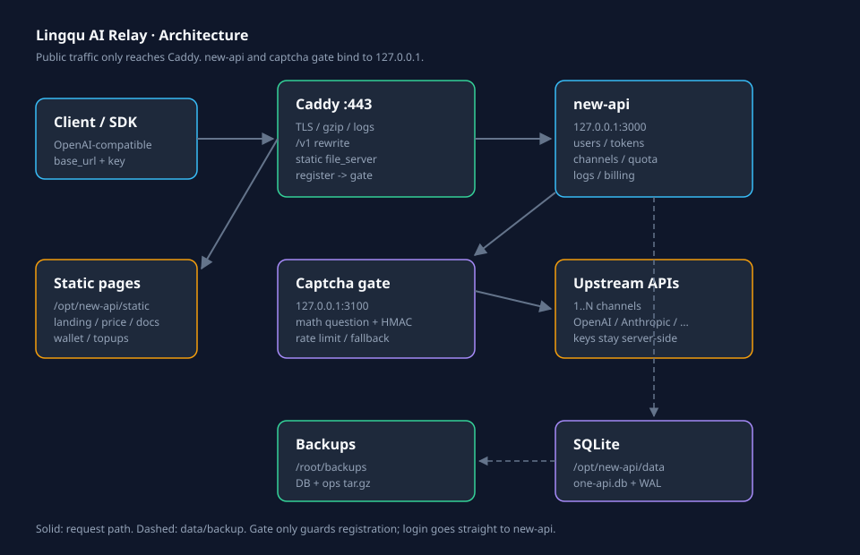

# 灵渠 AI 中转站 · new-api + Caddy 复刻手册

> 用一台小服务器，把多个上游 AI API 聚合成一个 **OpenAI 兼容入口**，带用户、令牌、额度、充值、自定义前端、注册验证码、监控和备份。
>
> 这是**脱敏模板**：域名、邮箱、密钥、支付账号全部用占位符。照着填自己的。
>
> - 适用：Ubuntu 22.04 / 24.04
> - 架构：Docker + new-api + Caddy + SQLite
> - 实测规模：2 核 / 1.5–2GB 内存 / 40GB 盘，日请求量不大的个人站
> - 文档更新：2026-11
> - 不会用 AI？看这份 `README.md`。
> - 想让 AI 装？把 `AI-DEPLOY.md` 整个丢给 AI。

---

## 目录

- [0. 先读：这不是“无脑赚钱站”](#0-先读这不是无脑赚钱站)
- [1. 它能做什么](#1-它能做什么)
- [2. 架构](#2-架构)
- [3. 准备清单](#3-准备清单)
- [4. 十步部署](#4-十步部署)
- [5. 目录与文件](#5-目录与文件)
- [6. 计费与额度](#6-计费与额度)
- [7. 注册验证码网关](#7-注册验证码网关)
- [8. 监控、备份、恢复](#8-监控备份恢复)
- [9. 常用运维命令](#9-常用运维命令)
- [10. 排错表](#10-排错表)
- [11. 安全清单](#11-安全清单)
- [12. 成本与合规](#12-成本与合规)
- [附录 A：验收清单](#附录-a验收清单)
- [附录 B：文件说明](#附录-b文件说明)

---

## 0. 先读：这不是“无脑赚钱站”

这套东西技术上不难，难的是**合规和上游条款**。

- 你转卖的 API 可能违反上游服务条款。
- 你需要处理用户数据、支付、退款、滥用。
- 你需要自己承担内容合规责任。
- 不要把它做成“免登录、免验证、随便刷”的公开站。

**建议用途**：

- 自己多个上游 key 的统一入口
- 小团队内部使用
- 有明确授权的分发
- 学习 new-api / Caddy / Docker 的完整项目

如果你只是自己用，其实不需要这么复杂：一个 new-api 容器 + Caddy 就够了。用户、充值、前端是“对外运营”才需要的。

---

## 1. 它能做什么

| 能力 | 说明 |
|---|---|
| 统一入口 | 一个 `base_url` + 一个 key，调用多个上游模型 |
| OpenAI 兼容 | `/v1/chat/completions`、`/v1/models`、`/v1/responses` 等 |
| 多渠道 | 一个模型可配多个上游，失败自动切换（按 new-api 策略） |
| 用户体系 | 注册、登录、令牌、额度、分组 |
| 计费 | 按 token 或按次，倍率可调 |
| 充值 | 对接易支付等（可选） |
| 自定义前端 | 落地页、价格页、文档页、钱包页 |
| 注册验证 | 自建算术题网关，挡机器注册 |
| 可观测 | 模型健康探测、上游比价、访问日志 |
| 可恢复 | SQLite 在线备份 + 配置文件打包 |

---

## 2. 架构



```text
用户 / SDK
    │  https://www.YOUR_DOMAIN
    ▼
Caddy (443)
    ├─ 自动 HTTPS、gzip/zstd、访问日志
    ├─ /api/user/register ──► captcha-gate (127.0.0.1:3100)
    ├─ /lq/captcha*       ──► captcha-gate
    ├─ /, /price, /docs, /wallet ... ──► /opt/new-api/static/*.html
    ├─ /chat/completions, /responses, /messages ──► 自动补 /v1
    └─ 其余 ──► reverse_proxy 127.0.0.1:3000
                          │
                    new-api 容器
                          │
                    SQLite /opt/new-api/data/one-api.db
                          │
                    多个上游渠道
```

**关键设计**：

1. 对外只开 443（和 80 用于 ACME）。
2. new-api 只监听 `127.0.0.1:3000`，不直接暴露。
3. 静态页面由 Caddy 直接读盘，改 HTML 不用重启容器。
4. 注册走验证码网关；登录不走。
5. `/chat/completions` 等三条 rewrite，让客户端漏写 `/v1` 也能用。

---

## 3. 准备清单

### 3.1 服务器

| 项 | 最低 | 推荐 |
|---|---|---|
| 系统 | Ubuntu 22.04 | Ubuntu 24.04 |
| CPU | 1 核 | 2 核 |
| 内存 | 1.5GB | 2GB |
| 磁盘 | 20GB | 40GB |
| 带宽 | 3M | 5M+ |
| 架构 | x86_64 | x86_64 |

> 1.5GB 内存能跑，但 Docker + Caddy + 备份同时跑会紧张。2GB 更稳。
> 不要用 512MB 小鸡，构建/升级会 OOM。

### 3.2 域名与 DNS

- 一个域名，能改 DNS。
- 两条 A 记录：
  - `@` → 服务器 IP
  - `www` → 服务器 IP
- 国内服务器需要备案；香港/海外不需要（但延迟/合规不同）。

### 3.3 端口

| 端口 | 用途 | 必须 |
|---|---|---|
| 22 | SSH | 是 |
| 80 | ACME 证书验证 | 是 |
| 443 | 网站/API | 是 |
| 3000 | new-api | **只监听 127.0.0.1** |
| 3100 | 验证码网关 | **只监听 127.0.0.1** |

### 3.4 上游

- 至少 1 个上游 API：`base_url` + `key` + 支持的模型列表。
- 建议 2–3 个做冗余。
- **不要把上游 key 写进 Git。**

### 3.5 支付（可选）

- 易支付/其他聚合支付的 `pid`、`key`、`notify_url`。
- 不接支付也能用：手动充值/兑换码。
- 接支付前先小额测试到账。

---

## 4. 十步部署

> 以下命令默认用 `root`。普通用户请加 `sudo`。
> 把 `YOUR_DOMAIN` 换成你的域名，例如 `api.example.com`。

### 第 1 步 · DNS

在域名后台加：

```text
A  @    YOUR_SERVER_IP
A  www  YOUR_SERVER_IP
```

验证：

```bash
dig +short YOUR_DOMAIN
dig +short www.YOUR_DOMAIN
```

两个都返回服务器 IP 再继续。

### 第 2 步 · 装依赖

```bash
apt update
apt install -y docker.io docker-compose-v2 caddy sqlite3 python3 curl rsync
systemctl enable --now docker
```

验证：

```bash
docker --version
docker compose version
caddy version
sqlite3 --version
```

> 如果 `docker-compose-v2` 找不到，用 `docker-compose-plugin` 或 `apt install docker-compose`。

### 第 3 步 · 起 new-api

```bash
mkdir -p /opt/new-api/data /opt/new-api/static
cd /opt/new-api
```

把仓库的 `deploy/docker-compose.yml` 复制到 `/opt/new-api/docker-compose.yml`：

```bash
cp /root/lingqu-relay/deploy/docker-compose.yml /opt/new-api/docker-compose.yml
cd /opt/new-api
docker compose up -d
```

验证：

```bash
docker ps --filter name=new-api
curl -s -o /dev/null -w '%{http_code}\n' http://127.0.0.1:3000/api/status
```

期望 `200`。

> 首次启动会拉镜像，几分钟正常。看日志：`docker logs -f new-api`。

### 第 4 步 · 配 Caddy

```bash
cp /root/lingqu-relay/deploy/Caddyfile.example /etc/caddy/Caddyfile
DOMAIN=api.example.com
EMAIL=admin@example.com
sed -i "s/YOUR_DOMAIN/$DOMAIN/g; s/YOUR_EMAIL/$EMAIL/g" /etc/caddy/Caddyfile
```

> 上面只是示例。把 `DOMAIN` 换成你的真实域名（不带 `www`），`EMAIL` 换成你的邮箱。
> 也可以直接用编辑器打开 `/etc/caddy/Caddyfile` 手工替换。

检查并重载：

```bash
caddy validate --config /etc/caddy/Caddyfile
systemctl reload caddy
systemctl status caddy --no-pager
```

验证 HTTPS：

```bash
curl -sI https://www.YOUR_DOMAIN | head -5
```

期望 `HTTP/2 200` 或 `301/302`。

> 证书由 Caddy 自动申请。80 端口必须对公网可达，否则 ACME 失败。

### 第 5 步 · 建管理员

浏览器打开：

```text
https://www.YOUR_DOMAIN
```

首次会提示初始化，按提示建管理员账号。

> 立即做：
> 1. 改默认密码。
> 2. 开启登录验证（如果有）。
> 3. 关闭公开注册（先），等验证码网关配好再开。

### 第 6 步 · 接渠道

后台 → 渠道 → 新建：

| 字段 | 填什么 |
|---|---|
| 类型 | OpenAI 兼容 / 对应上游类型 |
| Base URL | 上游给的地址，通常以 `/v1` 结尾 |
| Key | 上游 key |
| 模型 | 上游支持的模型名，一行一个 |
| 分组 | 默认 / VIP（可选） |

保存后点“测试”，或：

```bash
NEWAPI_BASE=http://127.0.0.1:3000 NEWAPI_KEY=你的令牌 python3 scripts/probe-models.py
```

> 不要把所有模型都填上。只填上游真的有的，否则模型页一片红。

### 第 7 步 · 计费与额度

后台 → 设置：

| 配置 | 建议 | 说明 |
|---|---|---|
| Price | 1 | 1 元 = 1 美元额度（按你定价） |
| QuotaPerUnit | 500000 | 1 美元 = 500000 quota |
| MinTopUp | 1 | 最低充值 |
| QuotaForNewUser | 0 | 新用户不送额度 |
| 注册 | 先关 | 配好验证码再开 |

价格表建议由脚本生成，不要手改 JSON。

### 第 8 步 · 注册验证码网关

```bash
cp /root/lingqu-relay/deploy/turnstile_gate.py /root/turnstile_gate.py
cp /root/lingqu-relay/deploy/turnstile-gate.service /etc/systemd/system/turnstile-gate.service
systemctl daemon-reload
systemctl enable --now turnstile-gate
systemctl status turnstile-gate --no-pager
```

验证：

```bash
curl -s http://127.0.0.1:3100/lq/captcha
```

期望返回 JSON，含 `token` 和 `q`。

Caddy 里确认这两条指向 3100：

```text
handle /lq/captcha* {
    reverse_proxy 127.0.0.1:3100
}
handle /api/user/register {
    reverse_proxy 127.0.0.1:3100
}
```

> 这个网关是**自建算术题**，不是 Cloudflare Turnstile。
> 它生成 `token`，前端把答案一起提交，网关校验后才转发给 new-api。
> 密钥文件 `/root/lq_captcha.secret` 自动生成，**不要提交**。

### 第 9 步 · 定时任务

```bash
crontab -l > /tmp/crontab.bak 2>/dev/null || true
crontab /root/lingqu-relay/deploy/crontab.example
crontab -l
```

示例任务：

| 时间 | 脚本 | 作用 |
|---|---|---|
| `30 4 * * *` | `backup.sh` | 每日备份 |
| `40 4 * * *` | `probe-models.py` | 模型健康探测 |
| `*/10 * * * *` | `health-check.sh` | 站点巡检 |
| `21 * * * *` | 价格表生成 | 对外报价 |

> 改 crontab 前一定备份。Windows 写的脚本带 BOM 会导致 `crontab` 解析失败。

### 第 10 步 · 验收

```bash
bash /root/lingqu-relay/scripts/health-check.sh
bash /root/lingqu-relay/scripts/backup.sh
ls -lh /root/backups
```

浏览器逐项检查：

- [ ] `https://www.YOUR_DOMAIN` 能打开
- [ ] 后台能登录
- [ ] 渠道测试通过
- [ ] `/v1/models` 返回模型列表
- [ ] 注册页出现验证码
- [ ] 登录不经过验证码
- [ ] 价格页/文档页/钱包页能开
- [ ] 小额充值能到账（如果接了支付）
- [ ] `crontab -l` 有任务
- [ ] `/root/backups` 有当天文件

---

## 5. 目录与文件

```text
/opt/new-api/
├─ docker-compose.yml
├─ data/
│  ├─ one-api.db          ★ 核心库
│  ├─ one-api.db-wal      ★ 备份不能只拷 .db
│  └─ logs/
└─ static/                ★ 自建前端，Caddy 直读
   ├─ landing.html
   ├─ price.html
   ├─ docs.html
   ├─ wallet.html
   ├─ topups.html
   ├─ vendor.html
   ├─ price_watch.html
   └─ _app.html

/etc/caddy/Caddyfile
/etc/systemd/system/turnstile-gate.service
/root/turnstile_gate.py
/root/lq_captcha.secret    ★ 自动生成，绝不提交
/root/backups/
/root/lingqu-relay/        ← 本仓库
```

---

## 6. 计费与额度

### 6.1 三个概念

| 概念 | 说明 |
|---|---|
| `quota` | new-api 内部额度单位 |
| `Price` | 1 元人民币换多少美元额度 |
| `QuotaPerUnit` | 1 美元 = 多少 quota |
| 模型倍率 | 不同模型消耗不同 quota |

### 6.2 定价步骤

1. 先算上游成本：每 1M input/output token 多少钱。
2. 加毛利（建议 ≥30%，覆盖汇率/失败请求/手续费）。
3. 在后台设置模型倍率。
4. 生成对外价格页。
5. 小额测试：充 1 元，发 1 条请求，看扣费对不对。

### 6.3 不要做的事

- 不要 1 元无限量。
- 不要给新用户送大额额度。
- 不要不做限流。
- 不要用手改数据库改余额。

---

## 7. 注册验证码网关

### 7.1 它怎么工作

```text
浏览器 GET /lq/captcha
  → 网关生成 a+b 或 a-b，签名 token
  → 返回 { token, q }

用户填答案
  → POST /api/user/register，带 token|答案
  → 网关校验签名/过期/答案
  → 通过则转发给 new-api
```

### 7.2 为什么不用现成 Turnstile

- 国内访问 Cloudflare 不稳定。
- 需要额外配置 site key / secret。
- 自建算术题够挡大部分脚本，且无第三方依赖。

### 7.3 注意

- 网关只保护注册，不保护登录。
- 同 IP 有频率限制（默认 120 次/小时）。
- 有 5 次/小时的“无验证码兜底”，防止组件坏了完全无法注册。
- 密钥文件不要备份到公开仓库。

---

## 8. 监控、备份、恢复

### 8.1 每日备份

`scripts/backup.sh`：

- SQLite 在线备份（含 WAL 合并）
- 打包 compose、static、Caddyfile、systemd、gate、crontab
- 默认保留 7 天 DB / 14 天配置
- 可选 rsync 到远程

```bash
BACKUP_REMOTE=user@backup-host:/backups/ bash scripts/backup.sh
```

### 8.2 恢复

```bash
# 1. 装依赖
apt update && apt install -y docker.io docker-compose-v2 caddy sqlite3 python3

# 2. 解包配置
mkdir -p /opt/new-api
tar xzf /root/backups/ops-XXXX.tar.gz -C /

# 3. 放回 DB
mkdir -p /opt/new-api/data
cp /root/backups/one-api-XXXX.db /opt/new-api/data/one-api.db

# 4. 起服务
cd /opt/new-api && docker compose up -d
systemctl daemon-reload
systemctl enable --now turnstile-gate caddy

# 5. 恢复 cron
crontab /root/ops/crontab.txt

# 6. 验证
curl -sI https://www.YOUR_DOMAIN | head -3
```

> 换 IP 后先改 DNS，等生效再 reload Caddy 重新签证书。

### 8.3 备份要放异地

原备份和服务器同盘，机器挂了会一起没。至少加：

- 对象存储（R2 / OSS / S3）
- 另一台机器 rsync
- 本地下载一份

---

## 9. 常用运维命令

```bash
# 状态
docker ps
docker stats --no-stream
systemctl status caddy --no-pager
systemctl status turnstile-gate --no-pager

# 日志
docker logs --tail 100 new-api
journalctl -u caddy -n 50 --no-pager
journalctl -u turnstile-gate -n 50 --no-pager

# 重启
cd /opt/new-api && docker compose restart
systemctl reload caddy

# 备份
bash /root/lingqu-relay/scripts/backup.sh

# 健康检查
bash /root/lingqu-relay/scripts/health-check.sh

# 模型探测
NEWAPI_BASE=http://127.0.0.1:3000 NEWAPI_KEY=xxx \
  python3 /root/lingqu-relay/scripts/probe-models.py
```

---

## 10. 排错表

| 现象 | 可能原因 | 处理 |
|---|---|---|
| 502 | 容器挂了 / 内存不足 | `docker logs new-api`、`free -h`、`docker stats` |
| 证书错误 | 80 端口不通 / DNS 未生效 | 放行 80，等 DNS，`systemctl reload caddy` |
| 模型页一片红 | 渠道里有没配的模型 | 删模型或补渠道，重跑探测 |
| 401/403 | 上游 key 失效 | 更新渠道 key |
| 429 | 限流 | 调大 new-api 限流；查上游额度 |
| 注册 400 | 验证码错/过期 | 刷新验证码；看网关日志 |
| 注册 429 | 同 IP 频率 | 等几分钟；调 `RATE_MAX` |
| 充值不到账 | 回调地址/密钥不一致 | 对后台 notify_url 和支付配置 |
| DB 锁 | 备份撞大事务 | `docker restart new-api` |
| 升级后崩 | `latest` 拉到新版本 | 先备份，回退镜像 |
| SSH 超时 | fail2ban 封禁 | 等 10–15 分钟，别连续试密码 |
| 磁盘满 | 日志/备份/镜像 | `docker system prune`、清旧备份 |

---

## 11. 安全清单

- [ ] new-api 只监听 `127.0.0.1:3000`
- [ ] 网关只监听 `127.0.0.1:3100`
- [ ] 对外只开 22/80/443
- [ ] SSH 用密钥，禁用密码登录（可选）
- [ ] 防火墙只放行必要端口
- [ ] 数据库文件权限 600
- [ ] `.env` / `lq_captcha.secret` 不进 Git
- [ ] 备份加密或放私有存储
- [ ] 管理员密码 ≥16 位
- [ ] 开登录失败限制
- [ ] 定期更新镜像/系统
- [ ] 不把后台暴露给所有人

---

## 12. 成本与合规

### 12.1 成本

| 项 | 量级 |
|---|---|
| 服务器 | 按你买的套餐 |
| 域名 | 每年几十元 |
| 上游 API | 按 token |
| 支付手续费 | 按支付商 |
| 备份存储 | 几 GB |

小站的主要成本是上游 token，不是服务器。

### 12.2 合规

- 遵守上游服务条款，不转卖禁止转卖的额度。
- 遵守当地法律，不提供违法内容。
- 保存必要的交易/日志，但注意隐私。
- 有明确的退款/滥用处理规则。
- 不要承诺“永久可用”“无限额度”。

---

## 附录 A：验收清单

```text
[ ] DNS 生效
[ ] 80/443 可达
[ ] docker compose up -d 成功
[ ] /api/status 200
[ ] Caddy 证书正常
[ ] 后台能登录
[ ] 渠道测试通过
[ ] /v1/models 有模型
[ ] 注册验证码生效
[ ] 登录不经过验证码
[ ] 价格/文档/钱包页可开
[ ] 小额充值到账
[ ] cron 任务齐全
[ ] 备份文件存在
[ ] 健康检查通过
```

## 附录 B：文件说明

| 文件 | 用途 |
|---|---|
| `deploy/docker-compose.yml` | new-api 容器 |
| `deploy/Caddyfile.example` | 反代/静态/rewrite 模板 |
| `deploy/turnstile_gate.py` | 注册验证码网关 |
| `deploy/turnstile-gate.service` | systemd 单元 |
| `deploy/crontab.example` | 定时任务 |
| `scripts/backup.sh` | 备份 |
| `scripts/health-check.sh` | 健康检查 |
| `scripts/probe-models.py` | 模型可用性探测 |
| `scripts/bootstrap-ubuntu.sh` | 依赖安装 + 目录初始化 |
| `AI-DEPLOY.md` | 给 AI 的执行手册 |

---

## 最后

这份文档只负责“怎么搭”。**不提供**上游 key、支付账号、绕过风控、盗刷、免备案方案。

先在小规模、可关闭的环境里跑通，再考虑对外。任何涉及钱和用户数据的功能，都要先小额测试、再放量。